  

  
  
  
  

## Salut, moi c'est Cheun 👋

Élève ingénieur en 5e année à l'**ISEN Brest**, en alternance chez **IFREMER**. Je conçois des applis web, des outils pour la recherche scientifique et, dès que j'ai un moment, des jeux vidéo.

## 🕹️ Projets phares

| | Projet | En bref | Stack |
|:-:|---|---|---|
| ♟️ | [**Chess IA**](https://github.com/Choopsy/Chess_IA_Project) · *en cours* | Une IA d'échecs construite étape par étape, de l'aléatoire à l'alpha-bêta, mesurée en tournoi contre Stockfish | Python · pygame |
| 🧟 | **Zombie Factory** | Produire le jour, survivre la nuit : gestion d'usine sur tapis roulants et défense contre une horde qui s'adapte | Python · pygame |
| 🍲 | [**Cook Book**](https://github.com/Choopsy/cook_book) | Le livre de recettes de la famille : mode cuisine, portions ajustables, nutrition calculée avec la base CIQUAL | Next.js · Supabase |
| 🌊 | **Galaxy Tools · OGS** | Stage R&D : l'Eutrophication Workbench (Blue-Cloud) transformé en workflow Galaxy reproductible | Python · Galaxy · Docker |
| 🌳 | [**Arbres de Saint-Quentin**](https://github.com/Choopsy/Projet---Partie-Web) | 9 915 arbres sur une carte interactive, et trois modèles d'IA pour aider la ville à décider | PHP · MySQL · scikit-learn |
| ⏳ | **FocusFlow** | Une appli de concentration gamifiée : XP, niveaux, badges et amis en temps réel | Vue 3 · Supabase |

Les projets sans lien sont dans des dépôts privés : ils sont tous présentés sur <a href="https://cheunperret.fr">cheunperret.fr</a>.

## 🧰 Ma boîte à outils

**Langages** 

**Front-end** 

**Back-end & API** 

**Bases de données** 

**Data & IA** 

**DevOps & outils** 

**Game dev** 

**Gestion de projet & design** 

## 🎮 Hors du code

🏸 Badminton · 🏃 Course à pied · 🎸 Guitare · 🤿 Plongée · 🎮 Jeux vidéo

---

INSERT COIN TO CONTINUE · <a href="https://cheunperret.fr">cheunperret.fr</a>

